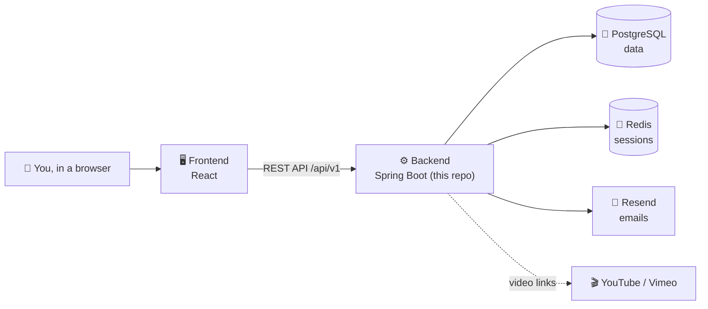

<a id="readme-top"></a>

<div align="center">


<h1>Manara · Backend</h1>

<p><strong>The brain of Manara, an online school where teachers share courses and students learn.</strong></p>

<p>
  
  
  
  
  
  
  
</p>

<p>
  <a href="https://github.com/Manara-Education/frontend-foundation"><strong>See the frontend »</strong></a>
  ·
  <a href="https://github.com/Manara-Education/backend-foundation/issues">Report a bug</a>
  ·
  <a href="https://github.com/Manara-Education/backend-foundation/issues">Request a feature</a>
</p>

</div>

<details>
  <summary><strong>📑 Table of contents</strong></summary>
  <ol>
    <li><a href="#-explain-it-like-im-5">Explain it like I'm 5</a></li>
    <li><a href="#-about-the-project">About the project</a></li>
    <li><a href="#-how-it-fits-together">How it fits together</a></li>
    <li><a href="#-getting-started">Getting started</a></li>
    <li><a href="#-usage">Usage</a></li>
    <li><a href="#-project-structure">Project structure</a></li>
    <li><a href="#-contributing">Contributing</a></li>
    <li><a href="#-security">Security</a></li>
    <li><a href="#-license">License</a></li>
    <li><a href="#-team">Team</a></li>
    <li><a href="#-acknowledgments">Acknowledgments</a></li>
  </ol>
</details>

---

## 🧸 Explain it like I'm 5

**Manara** (منارة) means **lighthouse**: a light that shows you the way. 💡

Manara is a **school on the internet**:

- 👩‍🏫 **Teachers** make courses with videos, lessons and quizzes.
- 🧑‍🎓 **Students** join a course, watch the lessons, take the quizzes and see how far they've got.

Now think of a restaurant. 🍽️

| In a restaurant | In Manara |
|---|---|
| 🪑 The **dining room**, where you sit, read the menu and order | The **frontend**: the website you see and click ([its own repo](https://github.com/Manara-Education/frontend-foundation)) |
| 👨‍🍳 The **kitchen**, which takes the order, follows the recipes and cooks the food | **This repo, the backend**: it takes requests, follows the rules and sends back answers |
| 🧊 The **fridge**, where everything is kept | **PostgreSQL**, the database that remembers users, courses, lessons and quiz results |
| 📋 The **list of who is sitting at which table** | **Redis**, which remembers who is logged in right now |

You never see the kitchen, but without it, nobody eats. 😄

<p align="right">(<a href="#readme-top">back to top</a>)</p>

---

## 💡 About the project

This is a **Spring Boot 4** REST API written in **Java 25**. It powers everything the Manara website does.

### ✨ Features

- 🔐 **Accounts**: sign up, verify your email with a one-time code, log in, reset a forgotten password
- 🍪 **Safe sessions**: login lives in a secure cookie backed by Redis, with CSRF protection
- 👥 **Three roles**: Student, Instructor and Admin, each allowed to do different things
- 📚 **Courses and lessons**: instructors build and publish courses, and anyone can browse the public catalog
- 🎬 **Video lessons** from YouTube and Vimeo
- 📝 **Quizzes** with attempts, automatic grading and course progress
- 🛒 **Checkout and enrollment**: payments run in a demo mode for now, with no real money
- 📊 **Dashboards**, 🖼️ **promotional banners**, ✉️ a **contact form**, 👤 **profiles**, and 📜 **terms and privacy** pages
- 📧 **Emails** sent with [Resend](https://resend.com/)
- 📖 **Interactive API docs** with Swagger UI

### 🧰 Built with

| Tool | What it does here |
|---|---|
| [Java 25](https://openjdk.org/) + [Spring Boot 4](https://spring.io/projects/spring-boot) | The language and framework the API is built with |
| [Spring Security](https://spring.io/projects/spring-security) | Logins, roles and protection against attacks |
| [PostgreSQL](https://www.postgresql.org/) | The main database |
| [Flyway](https://www.red-gate.com/products/flyway/) | Keeps track of every change to the database, step by step |
| [Redis](https://redis.io/) + [Spring Session](https://spring.io/projects/spring-session) | Remembers who is logged in |
| [Docker](https://www.docker.com/) | Runs the database, Redis and the app in containers |
| [springdoc-openapi](https://springdoc.org/) | Generates the Swagger API docs |

<p align="right">(<a href="#readme-top">back to top</a>)</p>

---

## 🧩 How it fits together



<p align="right">(<a href="#readme-top">back to top</a>)</p>

---

## 🚀 Getting started

### Prerequisites

- [JDK 25](https://adoptium.net/)
- [Docker Desktop](https://www.docker.com/products/docker-desktop/), for PostgreSQL and Redis

You don't need to install Maven. The project ships with the Maven wrapper (`./mvnw`).

### Installation

1. **Clone the repo**
   ```sh
   git clone https://github.com/Manara-Education/backend-foundation.git
   cd backend-foundation
   ```
2. **Create your settings file** and set `POSTGRES_PASSWORD` to any password you like
   ```sh
   cp .env.example .env
   ```
3. **Start the database and Redis**
   ```sh
   docker compose up -d postgres redis
   ```
4. **Run the backend** (it loads the settings from `.env` first)
   ```sh
   set -a && source .env && set +a
   ./mvnw spring-boot:run
   ```
5. **Open the API docs** at <http://localhost:8081/swagger-ui.html> 🎉

> [!TIP]
> Want everything, including the app itself, in Docker? Run `docker compose up --build`. The API is then on <http://localhost:8080>.

> [!IMPORTANT]
> Never commit `.env`, `application-local.properties` or any other file with secrets. They are git-ignored on purpose.

<p align="right">(<a href="#readme-top">back to top</a>)</p>

---

## 🧪 Usage

- **Try the API** in Swagger UI at <http://localhost:8081/swagger-ui.html>. Every endpoint is listed there with its inputs and outputs.
- **Use it with the website**: start the [frontend](https://github.com/Manara-Education/frontend-foundation). Its dev server already sends `/api` requests to `http://localhost:8081`.
- **Run all checks** (compile, run every test, package the jar). CI runs exactly this:
  ```sh
  ./mvnw -B -ntp verify
  ```

<p align="right">(<a href="#readme-top">back to top</a>)</p>

---

## 🗂️ Project structure

Every feature lives in its own folder under `src/main/java/com/manara/backend/`, with its own `controller`, `service`, `repository`, `model`, `dto` and `mapper`.

```text
com.manara.backend
├── auth/        🔐 Sign up, email verification, login, logout, password reset
├── session/     🍪 Login sessions stored in Redis
├── user/        👥 Users and their roles
├── profile/     👤 Your profile page
├── course/      📚 Courses, the public catalog, enrollment and progress
├── lesson/      📖 Lessons inside a course
├── video/       🎬 YouTube and Vimeo videos
├── quiz/        📝 Quizzes, attempts and grading
├── payment/     🛒 Checkout (demo mode for now)
├── dashboard/   📊 Numbers for the dashboards
├── banner/      🖼️ Promotional banners
├── contact/     ✉️ The contact form
├── email/       📧 Sending emails
├── terms/       📜 Terms of service
├── privacy/     🔏 Privacy policy
├── swagger/     📖 API docs setup
└── common/      🧰 Shared code used by every feature
```

Database migrations live in `src/main/resources/db/migration`.

<p align="right">(<a href="#readme-top">back to top</a>)</p>

---

## 🤝 Contributing

Please read **[CONTRIBUTING.md](CONTRIBUTING.md)** first. The short version:

1. Branch off `develop` with a prefix: `feat/`, `fix/`, `update/` or `remove/`
2. Name your PR like `[Area Emoji] - Sentence case description.`
3. Run `./mvnw -B -ntp verify` before you open the PR
4. Fill in the PR template and add a label

<p align="right">(<a href="#readme-top">back to top</a>)</p>

---

## 🛡️ Security

Found a security problem? **Please don't open a public issue.** Follow **[SECURITY.md](SECURITY.md)** instead.

---

## 📄 License

Distributed under the **Apache License 2.0**. See [LICENSE](LICENSE) for details.

---

## 👥 Team

<a href="https://github.com/Manara-Education/backend-foundation/graphs/contributors">
  
</a>

<p align="right">(<a href="#readme-top">back to top</a>)</p>

---

## 🙏 Acknowledgments

- [Spring Boot](https://spring.io/projects/spring-boot)
- [Best-README-Template](https://github.com/othneildrew/Best-README-Template), which this README is based on
- [Shields.io](https://shields.io/) for the badges
- [contrib.rocks](https://contrib.rocks/) for the contributors picture

<p align="right">(<a href="#readme-top">back to top</a>)</p>
